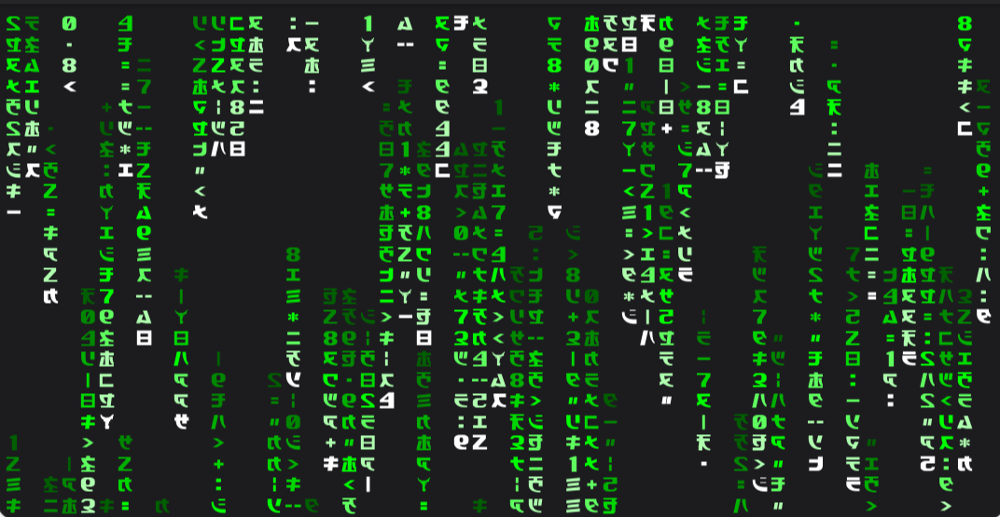

# matrix-code

The Matrix code as a terminal animation and screensaver. Columns of characters
stay in place while lit trails move down over them, as on the operator screens
in the films.



It runs on Linux and macOS in any terminal with 256 colors.

## Install

`install.sh` downloads the latest release for your system, checks it against
`SHA256SUMS` and runs its `install` command.

```sh
curl -fsSL https://raw.githubusercontent.com/hornc-greedy/matrix-code/main/install.sh | sh
```

To install by hand, download the archive for your system and `SHA256SUMS` from
the [releases page](https://github.com/hornc-greedy/matrix-code/releases).

| System | Archive |
| --- | --- |
| Linux on x86_64 | `matrix-code-x86_64-unknown-linux-musl.tar.gz` |
| Linux on arm64, for example a Raspberry Pi with a 64-bit system | `matrix-code-aarch64-unknown-linux-musl.tar.gz` |
| macOS on Apple silicon | `matrix-code-aarch64-apple-darwin.tar.gz` |

Check the archive, extract it and run the program's `install` command.

```sh
sha256sum --check --ignore-missing SHA256SUMS
tar -xzf matrix-code-x86_64-unknown-linux-musl.tar.gz
./matrix-code/matrix-code install
```

On macOS, check the archive with `shasum -a 256 --check --ignore-missing
SHA256SUMS`. The browser marks the downloaded archive as quarantined, and the
extracted program inherits the mark. Remove it before you run `install`.

```sh
xattr -d com.apple.quarantine matrix-code/matrix-code
```

`install` copies the program to `~/.local/bin`, the folder the XDG Base
Directory Specification names for a user's programs. It also copies the
bundled font and adds blocks to the startup files of the shell in `$SHELL`.
Each block starts with the comment
`` # Added by matrix-code, removed by `matrix-code uninstall` `` and ends with
`# End of matrix-code`.

| Shell | File | Block |
| --- | --- | --- |
| zsh | `~/.zshenv` | `~/.local/bin` on the `PATH` |
| bash on Linux | `~/.bashrc` | `~/.local/bin` on the `PATH` |
| bash on macOS | the first of `~/.bash_profile`, `~/.bash_login` and `~/.profile` that exists, otherwise a new `~/.bash_profile` | `~/.local/bin` on the `PATH` |

For other shells `install` prints the folder, and you add it to the `PATH`
yourself.

Quit the terminal with all its windows and start it again. The terminal then
loads the font, and its shells read the changed startup files. GNOME Terminal
and Ptyxis serve all their windows from one process. If the font was installed
before, `install` asks for `exec zsh` or `exec bash` instead, which loads the
changed startup files in the current window.

The Linux programs are statically linked and run on every distribution. To
build the program yourself, install Rust and run
`cargo install --locked --path .` in the checkout, then
`~/.cargo/bin/matrix-code install`. Run both again after each change.

## Use as a screensaver

After `install`, `screensaver` adds a block to `.zshrc` in `$ZDOTDIR`, by
default your home. The animation then starts once the prompt has waited at
least the seconds you give without a key press, here 300 seconds or five
minutes. Without seconds it also uses 300.

```sh
matrix-code screensaver 300
```

Open zsh windows keep their old settings until they reload. `exec zsh` loads
the change in the current window, and `&&` runs it only if the command before
it worked.

```sh
matrix-code screensaver 300 && exec zsh
```

`screensaver off` removes the block again.

```sh
matrix-code screensaver off && exec zsh
```

zsh calls `TRAPALRM` when no command is entered within `TMOUT` seconds after
the prompt appears, and again every `TMOUT` seconds while it keeps waiting. The
block sets `TMOUT` to the seconds you give, or 300. `TRAPALRM` starts the
program if `TTYIDLE`, the seconds since the last key press in the terminal, has
reached `TMOUT` as well. Typing at the prompt moves the start to a later call.
It replaces your own `TMOUT` and `TRAPALRM` if they come earlier in `.zshrc`.
bash has no such hook, so the screensaver needs zsh.

## Use

```sh
matrix-code
```

A key press ends it.

## The bundled font

The program includes a font for its characters. They lie in the
Supplementary Private Use Area-B from U+100000, which other fonts leave empty,
so the terminal falls back to this font without any setting.

The font goes to `$XDG_DATA_HOME/fonts`, by default `~/.local/share/fonts`,
on Linux or to `~/Library/Fonts` on macOS. On Linux this needs fontconfig's
`fc-cache`. Without `install` the first start copies the font as well and
still shows half-width katakana and digits in that run.

The Linux text console without a desktop cannot use fonts like this and shows
placeholders.

In JetBrains IDEs 2026.2 and earlier, the Reworked 2025 terminal engine counts
each of these characters as two cells but draws it in one, so the columns drift
apart ([IJPL-258252](https://youtrack.jetbrains.com/issue/IJPL-258252)). The
Classic engine, set under Settings, Tools, Terminal, Terminal engine, shows
them correctly.

## Uninstall

`uninstall` removes the font, the blocks from the startup files of zsh and
bash, and the program in `~/.local/bin`. A startup file that only held a block
is deleted.

```sh
matrix-code uninstall
```

If you installed it with `cargo install`, run `cargo uninstall matrix-code` as
well to remove its copy in `~/.cargo/bin`.

## Rebuild the font

`assets/matrix-code.ttf` is built from Rezmason's `Matrix-Code.ttf` with
[fontTools](https://github.com/fonttools/fonttools). The script is only needed
to change the font.

```sh
curl -L -o /tmp/Matrix-Code.ttf https://github.com/Rezmason/matrix/raw/b56f63b74b18da5ed5d807a01a0d9f9ac82f2c27/assets/Matrix-Code.ttf
uv run --with fonttools python tools/build_font.py /tmp/Matrix-Code.ttf
```

## License

The program is under the MIT License in `LICENSE`.

The glyphs of the bundled font come from
[Rezmason/matrix](https://github.com/Rezmason/matrix) and are under the MIT
License in `assets/LICENSE-font`. Rezmason took them from the vector graphics
of a promotional website for the game The Matrix: Path of Neo.
This project is not affiliated with Warner Bros.
